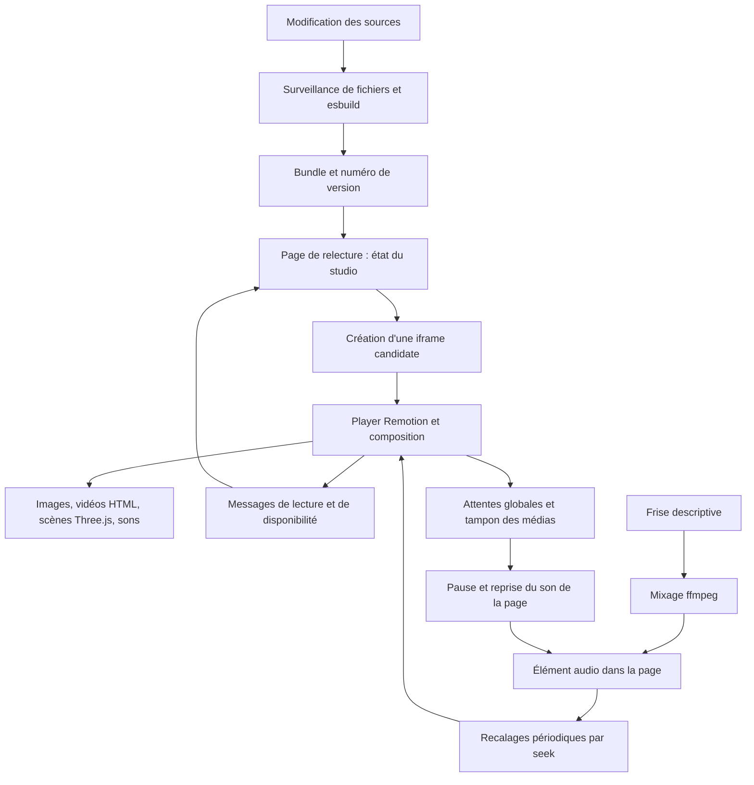

# Revue complète de la lecture dans Coulisses — 26 octobre 2026

## Conclusion et périmètre

**La relecture ne peut pas être considérée comme fiable dans son état actuel. Plusieurs défauts déterministes expliquent les images noires, les attentes et les changements de version incohérents.** Le préchargement global et l'attente globale ajoutés récemment introduisent des régressions. Les moteurs des projets ont aussi des cycles de vie coûteux ou incorrects que ces correctifs ne pouvaient pas réparer.

Les trois résultats les plus directement exploitables sont :

1. Après un saut, Coulisses attribue le chargement de la scène visible à une scène future. Reproduction en navigateur : l'horloge avance de l'image 220 à 299 sur du noir, avant de commencer à attendre.
2. Quitter une scène en cours de chargement laisse une poignée `delayRender` orpheline. La lecture suivante reste figée environ 20 secondes ; la pastille disparaît après 10 secondes. La libération au démontage supprime ce blocage dans la reproduction.
3. Lesson 0 change la structure React de `Live` vers `Freeze(Live)` à la sortie des saynètes : cela reconstruit le décor au milieu du fondu. Dans un scénario isolé de même structure, conserver `Freeze` et changer seulement `active` supprime un second montage et cinq secondes de noir.

Pour E15, le problème est aussi architectural : chaque montage fabrique environ **3,89 Gio de tableaux RGBA**, calculés à partir des dimensions des PNG réellement référencés. Deux générations peuvent en conserver environ **7,78 Gio**, avant les images décodées, temporaires et allocations GPU. Ce n'est ni une mesure de VRAM ni la preuve d'un plantage précis. Pour AItelier, certaines scènes créent jusqu'à **9 408 éléments `img`** ; les sept vidéos ne sont pas toute la charge.

**Je n'ai pas reproduit de plantage GPU ou de panne physique de la sortie audio.** Aucun des quatre fichiers `preview-errors.log` recherchés n'existait lors de la lecture. Les mécanismes de noir et de blocage sont démontrés ; attribuer tous les plantages rapportés à une saturation GPU serait aller au-delà des preuves. Le système ne journalise pas correctement la perte du contexte WebGL ou la disparition du processus d'aperçu.

Référence du code : `10633a9`, branche `main`, dépôt `C:\Users\owner\Documents\ChatGPT\Dev\remotion-studio`. Les numéros de lignes désignent cette révision, sauf mention contraire. Prototypes conservés sur la branche `revue-astra`, dans `C:\Users\owner\Documents\ChatGPT\Dev\coulisses-revue-astra`. Rien n'a été fusionné, poussé ou installé. Le seul fichier créé dans `main` est ce rapport.

Les projets réels, l'installation de Coulisses et les réglages personnels ont été laissés en lecture seule. Les studios de l'utilisateur n'ont reçu que des requêtes GET `/api/status` et `/api/log`. Les essais utilisent les ports 4189 et 4190, des profils Chrome séparés et muets, les réglages du bac à sable, et des dépendances existantes sans installation. Contrôle des ports 4170–4199 avant les essais ; aucun état `render`, `export` ou `shot` égal à `running` lors des contrôles. Les reproductions propres et les suites adaptées vérifient l'appartenance au bac à sable avec `requireSandbox`.

## Architecture réellement exécutée



La page est assemblée depuis `studio.html`, `C:\Users\owner\Documents\ChatGPT\Dev\remotion-studio\page\studio\NN-*.js` et `C:\Users\owner\Documents\ChatGPT\Dev\remotion-studio\page\studio.css`. `00-remote.js` conserve un état local optimiste et transmet les commandes ; `C:\Users\owner\Documents\ChatGPT\Dev\remotion-studio\player\bridge.js` appelle `StudioPlayer` et renvoie états et événements. L'autre origine isole le travail de la composition de celui de la page, **mais n'isole pas nécessairement les deux générations d'aperçu l'une de l'autre** : nos deux iframes `localhost` partagent des compteurs de tas V8. Le GPU et les décodeurs restent des ressources communes.

`C:\Users\owner\Documents\ChatGPT\Dev\remotion-studio\lib\player-build.mjs` remplace les imports `remotion` par `C:\Users\owner\Documents\ChatGPT\Dev\remotion-studio\player\sequence-window.tsx`, y compris pour les compositions génériques. `AssetsWait` inspecte un registre global de poignées de rendu toutes les 50 ms. `ready.ts` observe surtout les médias DOM ; il ne certifie pas le premier dessin WebGL. `sound.ts` remplace globalement `AudioContext`. Le son supplémentaire est activé pour les projets génériques Remotion (`G` dans `C:\Users\owner\Documents\ChatGPT\Dev\remotion-studio\studio-server.mjs:124–128`), pas pour tous les épisodes Brambleshire.

Une nouvelle iframe a son propre arbre React, ses objets `Image` et ses ressources Three.js ; les tableaux RGBA reconstruits ne sont pas partagés. Le cache HTTP ne préserve pas ces objets. L'ancienne reste présente pendant la préparation ; les vérifications actuelles n'assurent ni la disponibilité de l'image finale choisie ni l'identité immuable du code servi. Le son peut déjà avoir changé alors que l'ancienne image reste affichée.

Versions locales lues : Remotion et Player **4.0.533** pour Lesson 0, AItelier et 宇宙ちゃん ; **4.0.535** pour Brambleshire et le bac à sable par défaut ; React **19.2.3**. Les recommandations sont fondées sur ces sources locales. La documentation officielle distingue également l'attente du rendu et celle du Player, et demande de libérer les blocages au démontage : [état de tampon du Player](https://www.remotion.dev/docs/use-buffer-state), [attente de rendu](https://www.remotion.dev/docs/delay-render). Les changements des versions récentes de la documentation ne sont pas supposés présents dans 4.0.533.

## Classement des défauts

« Reproduit » signifie observé dans le bac à sable ou dans une simulation déterministe du code indiqué ; cela ne signifie pas qu'un studio réel a été piloté. « Établi par le code » distingue une propriété certaine du code d'une fréquence d'incident inconnue.

| Niveau | Référence | Défaut | Preuve principale | Correction et validation |
|---|---|---|---|---|
| Bloquant | B1 | La lecture traverse une scène non chargée après un saut | Noir capturé ; progression 220→299 | Désactivation du prémontage implicite prototypée ; attente ramenée à l'image 220 ; attribution globale à remplacer |
| Bloquant | B2 | Un chargement abandonné bloque une autre scène | 19,61 s figées après Lecture | Nettoyage de la poignée testé dans la copie de fixture ; projets réels non modifiés |
| Bloquant | B3 | Lesson 0 reconstruit la scène au début du fondu de sortie | Identité React et reproduction avec vrai `Freeze` | Structure stable testée : 2→1 montages, noir supprimé dans le scénario isolé |
| Grave | G1 | E15 recharge et reconstruit toutes ses ressources par génération | 681 fabrications, 3,89 Gio RGBA calculés | Chargement ciblé et voie vidéo à refondre ; pic des deux générations mesuré sur charge bornée |
| Grave | G2 | AItelier multiplie les bobines d'images et le flou dans le Player | Jusqu'à 9 408 `img` par instance | Diff de qualité d'aperçu proposé ; pas de modification réelle |
| Grave | G3 | `OffthreadVideo` n'attend pas forcément son décodage en aperçu | Source locale 4.0.533 et appels réels | `pauseWhenBuffering` explicite et proxies proposés ; saturation non reproduite |
| Grave | G4 | L'image préparée diffère de celle finalement affichée | Simulation : image 15 validée, image 180 affichée | Transaction de disponibilité et report des échanges pendant lecture proposés |
| Grave | G5 | Réponse tardive réinstallant v2 après v3 | Simulation du `loadCode` réel | Garde de génération prototypée et testée |
| Grave | G6 | Une expiration est traitée comme une image prête | Simulation du délai 90 s ; code des délais 10/30 s | Contrat explicite de disponibilité proposé ; pas de garantie 3D actuellement |
| Grave | G7 | Lesson 0 entend un autre mix que celui du rendu | Master normalisé ≠ somme des pistes décrites | Mix automatique à désactiver par défaut ; master explicite proposé |
| Grave | G8 | Deux horloges et attente audio héritée d'un ancien Player | Simulations des transitions | État de tampon lié à la génération proposé ; synchronisation à refondre |
| Grave | G9 | Mauvais fichier sonore sous la bonne signature ; WAV non invalidé | Reproductions A→B→A et WAV seul | Deux corrections du cache prototypées, simulations et suite existante validées |
| Grave | G10 | Le surveillant audio identifie le mauvais contexte | Contexte tiers et fermeture simulés | Suppression de la sous-classe globale proposée ; pas de validation navigateur du remplacement |
| Grave | G11 | Les canevas cachés échappent au sommeil ou au réveil | Fonctions réelles, racines R3F simulées | Toutes les racines traitées par `sleep`, prototype testé |
| Grave | G12 | Chaque sauvegarde provoque un remontage même sans changement visuel | Code et six constructions contrôlées | Empreinte des sorties esbuild prototypée et testée |
| Grave | G13 | Une version d'URL ne désigne pas un bundle immuable | Routes et fichier unique du constructeur | Publication par empreinte à réaliser ; refus des versions périmées proposé |
| Grave | G14 | Perte WebGL/processus non diagnostiquée, certaines attentes sans délai | Chemins de capture d'erreur et appels RPC | Surveillance et erreurs explicites proposées ; aucun plantage réel attribué avec certitude |
| Gênant, parfois grave | N1 | Une exception de dessin tue la boucle de frise | Dix injections déterministes | Réarmement de la boucle prototypé ; suite de dessin verte |

## Mesures et reproductions exécutées

Racine complète des preuves : `C:\Users\owner\Documents\ChatGPT\Dev\coulisses-revue-astra\.cache\revue-astra`. Les JSON contiennent les séries temporelles, pas seulement les moyennes. Les scripts sont conservés à côté. Les chargements de cinq secondes sont **injectés dans le bac à sable** ; ce ne sont pas des durées mesurées sur les projets réels.

| Essai | Résultat de la version initiale | Comparaison ou correctif | Trace |
|---|---|---|---|
| Saut dans une scène lente, prémontage 3 s | 97 échantillons sans scène ; image 220→299 ; attente seulement à 299 | Avec prémontage 0 : aucune progression au-delà de 220 avant disponibilité. L'image reste toutefois noire pendant l'attente : ce n'est pas une solution de lecture fluide | `seek-pre3-base.json`, `seek-pre0-base.json` |
| Entrer en 190, sortir en 50 avant fin de chargement | Image 50 figée 19,61 s après Lecture ; pastille masquée après 10 s | Libération au démontage : reprise 29,5 ms après le saut, avant Lecture ; l'attente légitime revient ensuite à l'entrée normale de la scène lente | `orphan-pre0-base.json`, `orphan-pre0-nettoyage.json` |
| Bascule de structure vers `Freeze` | Deux montages ; 100 échantillons de 50 ms sans scène autour de l'image 271 | `Freeze` permanent : un montage, aucun échantillon absent pendant la lecture, aucune seconde attente | `freeze-pre0-bascule.json`, `freeze-pre0-stable.json` |
| Deux générations, chacune avec 32 Mio de tableau synthétique | 34,56→69,10 Mio de stockage externe dans l'isolate d'aperçu ; page seule ≈1,54 Mio de tas utilisé | Après suppression et ramasse-miettes : 34,56 Mio ; pas de fuite permanente démontrée par cet essai | `memory-reload.json` |
| Préparation de la nouvelle version dans ce même essai | 7,80 s, dont chargement lent injecté de 5 s ; deux iframes présentes à 3,84 s | Le temps de compilation seul ne décrit pas ce délai | `memory-reload.json`, `memory-reload-serveur.log` |
| Lecture de l'aplat simple pendant ≈4,92 s | 149 événements, ≈30,09 changements d'image/s ; p95 34,1 ms ; écart maximal 50,1 ms | Cadence des événements, pas certification de pixels 3D présentés | `memory-reload.json` |
| Mémoire GPU du Chrome de test, relevé après lecture | Adaptateur 1 : 6,46 Mio dédiés +16,82 partagés ; adaptateur 2 : 156,46 Mio dédiés +5,77 partagés | Compteurs Windows du seul processus GPU de ce Chrome ; aucune extrapolation à E15 et aucun cumul avec le tas JS | `memory-reload.json` |
| Sauvegarde hors graphe, commentaire, frise seule | Le code initial incrémente toujours sa version | Prototype : v1, v1, v1, v2 après couleur, v3 après CSS, v3 après frise ; six notifications conservées ; 71–246 ms | `build-identity-resultat.json` |
| Réponses v2 et v3 dans l'ordre inverse | v2 réinstallée après v3 | v3 reste affichée après correction | `loadcode-race-traces.json` |
| Cache audio A→B→A et changement de WAV seul | B servi sous signature A ; aucune reconstruction pour WAV seul | A reste A ; une reconstruction pour le WAV ; pas de boucle sur échec inchangé | `audio-reproductions.json` |
| Exception de dessin | Plus aucune frame programmée | Reprise dans dix cas ; erreur toujours visible dans le journal | `frise-resultat.json` |

Attention aux mesures mémoire : les deux sessions CDP d'iframe retournent ici le même stockage V8 pendant leur coexistence. **Il ne faut pas additionner 69,10 Mio deux fois.** La mesure est celle de l'isolate partagé, pas une attribution indépendante par document. Le retour au niveau initial après ramasse-miettes distingue un pic temporaire d'une fuite.

Captures inspectées : [noir pendant le saut](<C:/Users/owner/Documents/ChatGPT/Dev/coulisses-revue-astra/.cache/revue-astra/seek-pre3-base.png>), [noir lors du remontage](<C:/Users/owner/Documents/ChatGPT/Dev/coulisses-revue-astra/.cache/revue-astra/freeze-pre0-bascule.png>), [lecture avec structure conservée](<C:/Users/owner/Documents/ChatGPT/Dev/coulisses-revue-astra/.cache/revue-astra/freeze-pre0-stable.png>). Les deux dernières captures sont prises au même délai après Lecture, pas à la même image : l'une des lectures a été bloquée.

Suites existantes relancées sur le worktree, avec adaptation de sécurité des chemins et vérification du bac à sable : `timeline-draw` **4/4**, `review-sound` **9/9**, `sound-tab` **4/4**, `typecheck` **1/1**. La suite originale `preview-premount` a également été relancée : **4/4** sur son scénario prévu. Son journal historique dans `main` était à **0/2**. Ces résultats actuels ne contredisent pas les contre-exemples : cette suite ne teste ni les sauts ni les démontages de scène et utilise 1,5 s de prémontage au lieu de 3 s.

Le lanceur complet `C:\Users\owner\Documents\ChatGPT\Dev\remotion-studio\tests\run-all.mjs` n'a pas été lancé : certaines suites emploient des ports interdits pour cette mission ou déclenchent des rendus sans rapport avec le défaut isolé. Les vérifications nécessaires aux prototypes sont détaillées ci-dessus et dans `suites-resultat.json`. Les tests ont conservé les sorties sonores muettes ; avancer une horloge audio n'est pas une mesure d'amplitude ni une écoute du master.

## Défauts bloquants — preuves, corrections, risques


### B1 — Attribution erronée des chargements après un saut

**Gravité : bloquant pour une relecture fidèle ; logique fautive prouvée, reproduction navigateur effectuée séparément par l'agent principal.**

Fichiers atelier :

- `C:\Users\owner\Documents\ChatGPT\Dev\remotion-studio\player\sequence-window.tsx:35–47` ;
- `C:\Users\owner\Documents\ChatGPT\Dev\remotion-studio\player\assets-wait.tsx:23–36`.

`VisualSequence` est présent dans l'arbre pour chaque séquence dès le montage de la composition. Ce sont ses enfants Remotion qui sont montés/démontés selon l'image. Pourtant la date `__coulissesActiveMountAt` est fixée par un initialiseur `useState` du **wrapper**, ligne 45 : elle n'est donc pas renouvelée lorsque ses enfants deviennent actifs après un saut.

Lorsqu'un handle apparaît, `AssetsWait` ne connaît ni son propriétaire, ni sa séquence. Si n'importe quel prémontage est présent et que la date précédente a plus de 600 ms, il affecte **tous** les nouveaux handles au début minimal de ce prémontage. Un chargement de la scène visible peut donc être ignoré jusqu'à une scène future. Même lorsque le registre des prémontages se vide, l'attribution initiale demeure dans `seen`.

Test exécuté directement sur le corps réel d'`AssetsWait`, types supprimés par Node, hooks et horloge contrôlés : image visible 130, prémontage d'une autre scène à 210, handle neuf 1, dernier montage supposé à 0 ms, temps 2 000 ms. Résultat : **0 appel à `delayPlayback()`**. Vider le registre de prémontage puis avancer à 3 000 ms garde **0 appel**. C'est exactement l'inverse de la promesse « après un saut : attendre aussitôt » du commentaire.

Le registre est aussi modifié pendant le rendu React (`PM.set/delete`, ligne 44), avant validation du rendu. Les séquences imbriquées ignorent `PremountContext.premountFramesRemaining` alors que Remotion le soustrait explicitement dans `usePremounting` (`remotion/dist/esm/index.mjs:3160–3161`). Ce sont des fragilités supplémentaires ; pas de reproduction spécifique des rendus interrompus ou imbrications dans cette revue.

**Retrait immédiat conseillé de l'inférence de propriété des handles, avec désactivation du prémontage automatique**. Patch conservateur pour rendre les attentes cohérentes ; il peut attendre trop tôt si un projet possède son propre prémontage, mais n'invente plus un propriétaire futur :

```diff
--- a/lib/player-build.mjs
+++ b/lib/player-build.mjs
@@
-const PREMOUNT = String(Number.isFinite(+process.env.COULISSES_PREMOUNT) && process.env.COULISSES_PREMOUNT !== '' ? +process.env.COULISSES_PREMOUNT : 3);
+const PREMOUNT = String(Number.isFinite(+process.env.COULISSES_PREMOUNT) && process.env.COULISSES_PREMOUNT !== '' ? +process.env.COULISSES_PREMOUNT : 0);
--- a/player/sequence-window.tsx
+++ b/player/sequence-window.tsx
@@
-const PREMOUNT_S = typeof __COULISSES_PREMOUNT__ === 'number' ? __COULISSES_PREMOUNT__ : 3;
+const PREMOUNT_S = typeof __COULISSES_PREMOUNT__ === 'number' ? __COULISSES_PREMOUNT__ : 0;
--- a/player/assets-wait.tsx
+++ b/player/assets-wait.tsx
@@
-        const P: Map<object, number> | undefined = W.__coulissesPremounting, recent = now - (W.__coulissesActiveMountAt ?? -1e9) < 600;
-        seen.set(h, { until: !recent && P && P.size ? Math.min(...P.values()) : null, due: null });
+        seen.set(h, { until: null, due: null });
```

Cette proposition est une stabilisation, pas la refonte finale. Un prémontage fiable nécessite des attentes appartenant explicitement au composant et libérées lors de son démontage ; `useBufferState()` fournit déjà des baux de blocage idempotents. Le composant propriétaire doit signaler si son chargement bloque l'image visible ; un tableau global de nombres ne permet pas de reconstruire cette information. Ne pas remplacer l'heuristique actuelle par une autre durée arbitraire.

**État du prototype :** les deux valeurs par défaut sont passées à zéro dans le worktree et le scénario navigateur est comparé dans les mesures ci-dessus. La suppression de l’heuristique `until` reste une proposition : elle bloquerait plus tôt les prémontages explicitement demandés par certains projets. La migration vers des attentes appartenant à la scène est indispensable.

### B2 — Poignées orphelines et blocage global de vingt secondes

**Gravité : bloquant ; défaut des nettoyages prouvé, conséquence nouvelle introduite par `AssetsWait`.**

Chemins et lignes :

- Brambleshire : `C:\Users\owner\Desktop\Youtube\music\Brambleshire\Théatre\06_Remotion\src\engine\Stage.tsx:30–61` ;
- Lesson0 : `C:\Users\owner\Desktop\Youtube\Jap for Eng\06_Theatre\06_Remotion\src\engine\Stage.tsx:30–74` ;
- fixture : `C:\Users\owner\Documents\ChatGPT\Dev\remotion-studio\tests\coulisses-fixture.mjs`, chaîne source du composant `Lent` ;
- AItelier : `C:\Users\owner\Desktop\Youtube\AItelier\remotion\src\scenes\SceneReact.tsx:144,177–197`, constat transmis par l'agent médias.

`useEpisodeAssets` crée un handle au montage. Son nettoyage ne fait que `alive = false`. La branche de succès n'appelle `continueRender(handle)` que lorsque `alive` reste vrai. Un saut hors de la scène pendant son chargement laisse donc un handle permanent. Dans la fixture, le nettoyage supprime le timer qui aurait libéré le handle, sans libérer ce dernier : **le jeu d'essai possède lui-même le défaut réel qu'il ne teste pas**.

Remotion 4.0.533 : `dist/esm/index.mjs:1223–1249` crée toujours le handle, mais le délai d'expiration est installé seulement lorsque `environment.isRendering` est vrai. Un handle orphelin n'expire pas automatiquement dans le Player. Coulisses le considère bloquant jusqu'à 20 s (`AssetsWait:16,34–39`) puis cesse de l'attendre sans le supprimer ni expliquer pourquoi.

Correctifs minimaux exacts recommandés, non appliqués aux projets réels :

```diff
--- a/src/engine/Stage.tsx
+++ b/src/engine/Stage.tsx
@@
-    return () => { alive = false; };
+    return () => { alive = false; continueRender(handle); };
```

Même modification pour les deux moteurs. `continueRender` supporte une seconde libération : il filtre le tableau ; un handle absent ne déclenche pas d'erreur (`dist/esm/index.mjs:1276–1291`). Pour AItelier, conserver le nettoyage existant et y ajouter la libération du handle identifié dans ce composant ; l'agent médias fournit le diff exact correspondant.

```diff
--- a/tests/coulisses-fixture.mjs
+++ b/tests/coulisses-fixture.mjs
@@
-  React.useEffect(() => { const t = setTimeout(() => { setOk(true); continueRender(h); }, ms); return () => clearTimeout(t); }, []);
+  React.useEffect(() => { const t = setTimeout(() => { setOk(true); continueRender(h); }, ms); return () => { clearTimeout(t); continueRender(h); }; }, []);
```

Risque faible pour la libération. Ce patch ne stoppe pas le travail déjà lancé : les promesses continuent de décoder les images et construire les textures après démontage. La vraie annulation doit empêcher les étapes de calcul inutiles et disposer les ressources détenues ; la géométrie `LAYERED_GEOMETRY` étant partagée, une destruction aveugle serait dangereuse.

#### Cas complémentaire AItelier

Fichier réel : `C:\Users\owner\Desktop\Youtube\AItelier\remotion\src\scenes\SceneReact.tsx`.

- Ligne 144 : `useState(() => delayRender(...))` crée la poignée.
- Lignes 177 et 189 : après chargement, un démontage fait `return`.
- Ligne 197 : le nettoyage fait seulement `annule = true`, sans `continueRender`.
- Ligne 227 : libération seulement après une première chorégraphie réussie.
- Lignes 228–232 : une erreur de chorégraphie en aperçu affiche une erreur sans libérer la poignée.

Reproduction recommandée : copie de la scène dans le bac à sable ; ralentir une image ; entrer dans la séquence, la quitter avant chargement ; vérifier que `window.remotion_delayRenderHandles` reste non vide alors que la séquence est démontée ; tenter Lecture. Le pont global introduit par `assets-wait.tsx` transforme une poignée jusque-là ignorée par le Player en attente globale pouvant durer vingt secondes. Preuve de contrôle de flux établie ; scénario AItelier spécifique non exécuté ; mécanisme reproduit dans la fixture.

Correction locale proposée, risque faible (libération au démontage et sur erreur affichée ; le rendu conserve son chemin `cancelRender`). Projet réel non modifié.

```diff
--- a/src/scenes/SceneReact.tsx
+++ b/src/scenes/SceneReact.tsx
@@
-    return () => { annule = true; };
+    return () => {
+      annule = true;
+      if (!libere.current) { libere.current = true; continueRender(attente); }
+    };
@@
-      if (env.isRendering) cancelRender(new Error(m)); else { console.error(m); setErreur(m); }
+      if (env.isRendering) cancelRender(new Error(m)); else {
+        console.error(m); setErreur(m);
+        if (!libere.current) { libere.current = true; continueRender(attente); }
+      }
```

**Validation ajoutée :** le scénario réel de la fixture a été reproduit avant/après libération au démontage : 19,61 secondes bloquées après Lecture deviennent une reprise avant Lecture. Il ne s’agit pas d’une attente infinie du Player : le plafond Coulisses est de 20 secondes ; la poignée orpheline, elle, reste dans le registre.

### B3 — Remontage de la scène de Lesson 0 pendant le fondu

**Gravité : bloquant ; défaut de code et remontage prouvés ; effet visuel sur le projet réel non exécuté ; structure reproduite en navigateur dans le bac à sable.**

Fichier : `C:\Users\owner\Desktop\Youtube\Jap for Eng\06_Theatre\06_Remotion\src\lesson0\Lesson0Montage.tsx`, lignes 120–125. La durée du fondu est de 0,35 s (ligne 21).

```tsx
{t < s.t1 ? <Live id={id} /> : <Freeze frame={n - 1}><Live id={id} /></Freeze>}
```

À `t = s.t1`, le nœud React change de type : `Live` devient `Freeze`. React démonte l'ancien `Live`, puis monte un nouveau `Live` sous le nouveau parent. Ce dernier reconstruit `Episode`, donc `useEpisodeAssets`. `Episode.tsx:27–46` ne monte le `ThreeCanvas` que lorsque `L` existe ; jusque-là reste son fond `#1a1510`, presque noir. Le fondu de sortie n'a que 0,35 s ; il vient d'être couplé à un nouveau chargement/construction de toutes les ressources de l'épisode. Le prémontage trois secondes avant l'entrée de la séquence ne peut pas préserver cette identité détruite à sa sortie.

Test léger exécuté avec le React 19.2.3 et `react-reconciler` 0.31.0 du projet : composant `Live` avec compteur dans `useEffect`, composant `Freeze` réduit à son enfant pour isoler l'identité React. Résultats :

```json
{"cas":"bascule Live vers Freeze(Live)","montages":2,"demontages":1}
{"cas":"Freeze conservé, active change","montages":1,"demontages":0}
```

Le véritable `Freeze` Remotion conserve lui aussi ses fournisseurs de contexte et son enfant lorsque `active` change (Remotion 4.0.533, `dist/esm/index.mjs:1974–2044`). Le test établit la cause de réconciliation ; il n'est pas une mesure du chargement 3D réel.

Correction exacte recommandée, **non appliquée au projet réel** :

```diff
--- a/src/lesson0/Lesson0Montage.tsx
+++ b/src/lesson0/Lesson0Montage.tsx
@@
-              {t < s.t1 ? <Live id={id} /> : <Freeze frame={n - 1}><Live id={id} /></Freeze>}
+              <Freeze frame={n - 1} active={t >= s.t1}><Live id={id} /></Freeze>
```

Risque faible : la dernière image figée est inchangée ; il faut néanmoins vérifier quelques images avant/après les trois sorties pour confirmer le fondu et l'horloge des bouches. Le test léger confirme le résultat attendu sur les montages, pas les pixels.

**Validation ajoutée :** le véritable `Freeze` Remotion a également été utilisé dans une composition de bac à sable avec chargement retardé. Deux montages et cinq secondes de noir avec la bascule de type ; un montage et aucun échantillon absent pendant la lecture avec `active`. Le projet réel reste inchangé.

## Défauts graves — charge, générations, médias et son

### G1 — E15 : coût intégral de chaque montage

**Gravité : grave ; volumes calculés sur les fichiers réels, pas mémoire processus mesurée.**

Le chargement `useEpisodeAssets` lit tous les plats de tous les décors (`Stage.tsx:43–45`), toutes les variantes d'objets (`47–49`) et toutes les poses de tous les personnages (`51–53`) avant de publier `L`. Le cache `img` est local à un montage et ne mémorise que les images, pas les textures fabriquées pour chaque référence.

`C:\Users\owner\Desktop\Youtube\music\Brambleshire\Théatre\06_Remotion\src\cardboard\cardboard.ts:163–198` crée un tableau `Uint8Array(w*h*4)` pour chaque `DataTexture`, plus un canvas, `getImageData`, les tableaux `solid` et `queued` de `w*h` chacun et des tableaux de frontières. C'est du travail CPU synchrone sur le thread de la page. `buildLayered:229–235` rappelle `exactTexture` à chaque fabrication, même lorsqu'une même image source est déjà chargée.

Inventaire obtenu uniquement par lecture d'`assets.json` et des 24 premiers octets de chaque PNG référencé (aucun décodage/image ouvert) :

| Groupe | Références fabriquées | Pixels | Tableau RGBA correspondant |
|---|---:|---:|---:|
| Plats | 244 | 416 794 361 | 1 589,94 Mio |
| Variantes d'objets | 233 | 305 942 966 | 1 167,08 Mio |
| Poses | 204 | 320 864 256 | 1 224,00 Mio |
| Total | 681 | 1 043 601 583 | 3 981,02 Mio = 3,89 Gio |

Les 681 références peuvent réutiliser un PNG physique : le nombre n'est pas une affirmation de 681 fichiers distincts. Les constructions par référence conservent toutefois des `DataTexture` distinctes. Les estimations excluent le mur, les effets, les images décodées, la géométrie, les temporaires et la mémoire GPU. Toutes les textures ne sont pas forcément transférées simultanément au GPU ; **ne pas appeler ce total une mesure de VRAM**.

`C:\Users\owner\Documents\ChatGPT\Dev\remotion-studio\page\studio\01-preview.js:79–81,105,138` conserve l'ancienne iframe pendant la préparation complète de la nouvelle. Si les deux mondes arrivent jusqu'à leurs tableaux complets, ce seul poste atteint environ **7,78 Gio**, avant les postes exclus. Les deux iframes ont des mondes JavaScript séparés ; un cache HTTP chaud ne réutilise ni ces tableaux ni la scène Three.js. Aucun correctif de son ou d'attente ne supprime ce coût.

Recommandation : vidéo de relecture/proxy à résolution raisonnable pour la lecture normale ; lecture 3D réservée à la scène/zone éditée ; ressources et poses à la demande ; cache borné partagé au niveau du moteur d'un même document avec comptage de références ; mise à jour des données sans détruire l'iframe tant que le graphe d'importation/composant le permet. Le passage à un autre bundle complet doit être une opération explicitement coûteuse, sérialisée, avec budget mémoire. Ces changements demandent un contrat de ressources ; aucun patch de cache global illimité n'est proposé comme correction sûre.

Atténuation immédiate exacte proposée, non appliquée : supprimer la préparation cachée au démarrage du lecteur vidéo et les reconstructions automatiques pendant sa lecture. Cette mesure réduit les pics inattendus ; elle ne rend pas un montage intégral d'E15 bon marché.

```diff
--- a/page/studio/10-start.js
+++ b/page/studio/10-start.js
@@
-        preloadCode();   // the live preview, ready behind for « Code actuel » and the staging (01-preview.js)
+        // La scène lourde sera chargée à la demande par setMode('code').
--- a/page/studio/02-notes.js
+++ b/page/studio/02-notes.js
@@
-      if (mode === 'code') { if (codeLoad?.ver !== ver) loadCode(); }   // shown when ready, at the frame and in the state of now
-      else if (codeLoad?.ver !== ver) loadCode();   // the MP4 shown: the preview made ready behind, asleep (01-preview.js)
+      if (mode === 'code' && M.paused && codeLoad?.ver !== ver) loadCode();
```

Risque : premier accès au code plus lent et corrections adoptées à la pause ; il faut afficher la version en attente. Ce diff n'empêche pas encore le pic des deux générations lors d'un échange demandé. Pour celui-ci, une politique de budget doit choisir une préparation séquentielle après libération de l'ancienne scène, ou une vidéo de relecture. Une réécriture sûre du cache de textures exige les règles de propriété et de destruction ; présenter un simple cache global illimité comme un correctif exact serait dangereux.


### G2 — AItelier : milliers d’images et flou de rendu dans le Player

Ce n'est pas seulement un problème de sept vidéos. `SceneReact.tsx:97–100` calcule `G = round(sous × 0,75)` ; ligne 136 emploie ce nombre aussi dans le Player ; lignes 178–182 exécutent `construire()` dans chaque copie ; lignes 185–188 attendent tous ses `img`.

Dans `C:\Users\owner\Desktop\Youtube\AItelier\remotion\src\runs\2026-10-24_deepseek-1017-meta\scenes\` :

- `panneau-s17-01.tsx:53,59–65` : flou `sous:10` ⇒ huit copies ; deux bobines de 588 images ⇒ **9 408 éléments img** montés et attendus par instance de scène.
- `s11-01.tsx:77–86,106` : 4 × 135 + 2 × 180 = 900 images, huit copies ⇒ **7 200 img**.
- `s15-01.tsx:66–73,97` : 2 × 300, huit copies ⇒ **4 800 img**.
- `i16-clips.tsx:45–49` : 900 img dès chaque montage, même avant le premier instant utile.

Les URLs identiques peuvent partager un cache d'images décodées : les comptes ci-dessus concernent le DOM, **pas une mesure de mémoire GPU**, et ne permettent pas de multiplier la mémoire par huit. En revanche les copies, gestionnaires d'événements, scans et chorégraphies supplémentaires sont certains. La nouvelle iframe recrée tout ce travail à chaque version.

Atténuation précise proposée (non prototypée) :

```diff
--- a/src/scenes/SceneReact.tsx
+++ b/src/scenes/SceneReact.tsx
@@
-  const G = sansFlou ? 1 : flou.G;
+  const G = sansFlou || !env.isRendering ? 1 : flou.G;
```

Risque : l'aperçu perd le flou temporel multi-échantillons ; le rendu final le conserve. Présenter cette différence comme une qualité d'aperçu sélectionnable. Correction durable : bobines remplacées dans l'aperçu par des vidéos intermédiaires légères, ou cache borné des images proches de la tête. Ne jamais promettre une fluidité générale avec trois secondes de prémontage.

### G3 — Le tampon vidéo échappe au pont global de rendu

Sources installées du projet AItelier :

- `C:\Users\owner\Desktop\Youtube\AItelier\remotion\node_modules\remotion\dist\cjs\video\OffthreadVideo.js:58–62` : en aperçu, `OffthreadVideo` utilise `VideoForPreview`, pas l'extraction exacte des images du rendu.
- `...\remotion\dist\cjs\v5-flag.js:4–6` : `ENABLE_V5_BREAKING_CHANGES = false`, donc `pauseWhenBuffering` omis donne `false`.
- `...\remotion\dist\cjs\use-media-playback.js:75–88` transmet ce booléen au tampon des médias et au premier décodage.
- `C:\Users\owner\Desktop\Youtube\AItelier\remotion\src\montage\Montage.tsx:64,82–84,94–95,113–114,151–153` : les vidéos ne spécifient pas cette propriété.

La présence d'une balise vidéo, ou le fait que l'horloge avance, ne prouve donc pas qu'une image soit décodée. L'effet de saturation est à mesurer ; le défaut de couverture du pont est établi par le code. Correction recommandée : composants vidéo d'aperçu avec `pauseWhenBuffering` explicite ; ce changement doit être testé avec la gestion du prémontage et l'horloge audio, pas appliqué aveuglément à toutes les séquences.

Exemple exact pour la première vidéo (idem aux autres appels) :

```diff
--- a/src/montage/Montage.tsx
+++ b/src/montage/Montage.tsx
@@
-    <OffthreadVideo src={media(m, c)} trimBefore={c.debut} muted style={PLEIN} />
+    <OffthreadVideo src={media(m, c)} trimBefore={c.debut} muted pauseWhenBuffering style={PLEIN} />
```

Non prototypé. Risque : davantage de pauses visibles si les sources restent trop lourdes ; remplacer les sources par des intermédiaires est alors nécessaire.

### G4 — L’image validée n’est pas celle adoptée

`C:\Users\owner\Documents\ChatGPT\Dev\remotion-studio\page\studio\01-preview.js:90,138,101–113` : chargement à `f0`, validation `whenReady` à `f0`, puis capture de `old.frame()` bien plus tard. L'ancienne iframe est retirée ligne 105 AVANT `sp.seek(f)` ligne 113. Il n'y a aucune validation après ce déplacement. Si les deux images sont de part et d'autre d'une coupe, les ressources validées n'ont aucun rapport avec la scène qui sera montrée. Le mécanisme vanté comme « prêt avant remplacement » ne respecte donc pas son invariant.

Preuve exacte : test `wrongFrame` valide image 15 ; l'ancienne avance à 180 ; trace `retire-iframe ancienne` puis `seek nouvelle-1 180`, sans seconde vérification. L'écran noir éventuel dépend du composant de destination ; l'absence de vérification est démontrée.

Correction à concevoir comme transaction : figer une cible (et, si nécessaire, suspendre brièvement la lecture), déplacer le candidat vers cette cible, attendre explicitement son état prêt réussi, vérifier que la demande et le Player affiché n'ont pas changé, puis échanger. En cas d'échec, conserver l'ancienne version. Éviter d'imposer un écran vide pour masquer le problème. Ce traitement mérite une modification coordonnée du protocole de disponibilité ; un simple ajout de `await whenReady()` conserve l'autre défaut (expiration traitée comme succès, ci-dessous).

Mesure immédiate exacte, conservatrice, NON PROTOTYPÉE : différer les échanges automatiques tant que l'utilisateur lit. Cela stabilise la cible ; cela ne dispense pas de revalider après déplacement manuel.

```diff
--- a/page/studio/02-notes.js
+++ b/page/studio/02-notes.js
@@
-      if (mode === 'code') { if (codeLoad?.ver !== ver) loadCode(); }
+      if (mode === 'code') { if (M.paused && codeLoad?.ver !== ver) loadCode(); }
```

Risque : les corrections ne deviennent visibles qu'à la pause ; il faut annoncer clairement « nouvelle version prête à préparer ». Le fichier actuel porte un commentaire en fin de ligne : appliquer le changement de condition, en conservant ou mettant à jour le commentaire.

### G5 — Une réponse tardive réinstalle une ancienne version

`C:\Users\owner\Documents\ChatGPT\Dev\remotion-studio\page\studio\01-preview.js:91–105` : `finish` efface `codeLoad` ligne 93, AVANT son `await old.stage.freePose()` ligne 102. Une nouvelle version démarre durant cet `await` ; elle ne marque plus l'ancien travail abandonné, puisque `codeLoad` a été effacé. Les réponses peuvent arriver dans l'ordre inverse. Le premier `finish` n'effectue aucune revalidation après l'attente ; il retire `codeEl` global (qui peut déjà être l'iframe suivante) et remet son ancien candidat.

Preuve VM : v3 installée, puis réponse retardée du `freePose` de v2 → v2 installée et iframe v3 retirée. La correction suivante a été PROTOTYPÉE DANS LA VM et TESTÉE : la même trace garde v3 et élimine le candidat v2. Correctif également appliqué dans le worktree seulement (`C:\Users\owner\Documents\ChatGPT\Dev\remotion-studio\page\studio\01-preview.js`) puis retesté avec les fonctions exactes de main et du worktree ; v3 reste affichée. Aucun fichier de main modifié.

```diff
--- a/page/studio/01-preview.js
+++ b/page/studio/01-preview.js
@@
       const finish = async (sp) => {
         clearInterval(job.tick);
-        if (codeLoad === job) { codeLoad = null; codeLoading = null; }
         if (job.dropped) return resolve(SP);
         if (!sp) {
+          if (codeLoad === job) { codeLoad = null; codeLoading = null; }
@@
         const pose = old && staging && old.stage ? plain(await Promise.resolve(old.stage.freePose()).catch(() => null)) : null, chosen = old && staging ? stSel?.id ?? null : null;
+        if (job.dropped || codeLoad !== job) return resolve(SP);
+        codeLoad = null; codeLoading = null;
         const queued = new Set(drafts().filter((n) => n.stage).map((n) => n.stage.id));
```

Risque : faible sur cette course ; ce correctif ne suffit pas pour toutes les opérations différées de mise en scène (lignes 116–129 utilisent elles aussi le `SP` global au lieu du candidat capturé). Le rétablissement des décors doit recevoir le Player attendu et vérifier son identité après chaque attente.

### G6 — Expiration confondue avec disponibilité

`C:\Users\owner\Documents\ChatGPT\Dev\remotion-studio\page\studio\01-preview.js:135–146` : échec de `whenReady()` absorbé par `.catch(() => {})`, puis expiration de 90 s considérée comme succès, et `finish(sp)` s'exécute. `C:\Users\owner\Documents\ChatGPT\Dev\remotion-studio\player\ready.ts:44` résout également après 30 s même si `why()` reste non nul ; sa promesse n'a aucun résultat permettant de distinguer réussite et expiration. `C:\Users\owner\Documents\ChatGPT\Dev\remotion-studio\player\r3f.ts:178–183` constate seulement la stabilité du nombre de maillages, pas le succès des chargements. Un montage peut être durablement incomplet, avoir le même nombre de maillages (y compris zéro) et passer la barrière.

Preuve VM : promesse `whenReady` jamais résolue ; déclenchement du minuteur 90 s → ancienne iframe détruite, candidat affiché. Ce n'est pas une durée mesurée de chargement : le temps est simulé.

Correction recommandée, NON PROTOTYPÉE : état explicite `ready | loading | error | timeout`, expiration = abandon de la préparation en conservant la version affichée. Correctif transitoire exact pour ne plus accepter le délai extérieur ; compléter aussi le contrat `ready.ts` pour ne pas résoudre faussement à 30 s :

```diff
--- a/page/studio/01-preview.js
+++ b/page/studio/01-preview.js
@@
-        if (!inPlace) await Promise.race([sp.whenReady().catch(() => {}), new Promise((r) => setTimeout(r, 90000))]);
+        if (!inPlace) {
+          const ready = await Promise.race([
+            sp.whenReady().then(() => sp.frameReady(), () => false),
+            new Promise((r) => setTimeout(() => r(false), 90000)),
+          ]);
+          if (!ready) { rem.api.dispose(); return finish(null); }
+        }
```

Risque : en l'état `frameReady()` est un cache par message ; cette mesure transitoire peut refuser un candidat prêt si l'état reçu est ancien. La correction définitive est une réponse RPC portant le résultat et l'image validée. Ne pas présenter ce diff transitoire comme une résolution complète de la disponibilité 3D.

`C:\Users\owner\Documents\ChatGPT\Dev\remotion-studio\player\ready.ts:19–25` ne voit que `<video>`, ``, les polices et le drapeau de buffering. Les `new Image()` du moteur, les textures et les premiers dessins WebGL ne font pas partie du DOM observé. `tick:35–36` émet `loaded` au bout de dix secondes même si `why()` continue de signaler un chargement ; `when:43–44` résout après trente secondes sans différencier réussite et expiration. Ces fonctions doivent séparer « masquer la pastille » et « image prête », et retourner un état d'expiration explicite.

La suppression du voile opaque dans c9ebbc3 est justifiée comme amélioration d'interface. Elle ne prouve pas que l'image est complète. Une simple modification CSS ne pouvait résoudre les causes de noir.

Complément exact proposé pour que la promesse interne ne réussisse plus après 30 secondes malgré un chargement toujours actif. À appliquer avec le traitement d'échec du candidat ci-dessus ; **non prototypé** :

```diff
--- a/player/ready.ts
+++ b/player/ready.ts
@@
-  const waiters = new Set<{ res: () => void; t: number; armed: boolean }>();
+  const waiters = new Set<{ res: () => void; rej: (error: Error) => void; t: number; armed: boolean }>();
@@
-    for (const w of [...waiters]) if (w.armed && (done || now - w.t > 30000)) { waiters.delete(w); w.res(); }
+    for (const w of [...waiters]) if (w.armed && (done || now - w.t > 30000)) {
+      waiters.delete(w);
+      if (done) w.res(); else w.rej(new Error('Préparation de l’image expirée après 30 secondes'));
+    }
@@
-    when: () => new Promise<void>((res) => {
-      const w = { res, t: performance.now(), armed: false }; waiters.add(w);
+    when: () => new Promise<void>((res, rej) => {
+      const w = { res, rej, t: performance.now(), armed: false }; waiters.add(w);
```

Risque : les appelants qui ignorent les rejets doivent être adaptés, notamment captures et récupération. Cette modification ne suffit pas à certifier une image WebGL : il faut un acquittement du premier dessin de la scène concernée. Le masquage d'une pastille doit rester une décision d'interface indépendante de cet acquittement. Ne pas déployer isolément ce diff comme une solution complète.


### G7 — Le mix de relecture n’est pas le master du film

Preuves croisées, lecture seule :

- `C:\Users\owner\Desktop\Youtube\Jap for Eng\06_Theatre\06_Remotion\src\lesson0\Lesson0Montage.tsx:140` joue `<Audio src={staticFile(MEDIA.mix)} />`.
- `C:\Users\owner\Desktop\Youtube\Jap for Eng\06_Theatre\06_Remotion\src\lesson0\data.ts:44` définit ce fichier comme `lesson0/mix.wav`.
- `C:\Users\owner\Desktop\Youtube\Jap for Eng\06_Theatre\06_Remotion\src\coulisses-timeline.ts:50` à 52 décrit séparément `voix.wav`, `musique.wav`, `sfx.wav`.
- `C:\Users\owner\Desktop\Youtube\Jap for Eng\10_Scripts\01_lesson0\montage\mix.py:175` à 181 somme les pistes puis applique une normalisation `loudnorm` en deux passes au master. Les pistes séparées sont écrites avant ce traitement, lignes 172-174.
- `C:\Users\owner\Desktop\Youtube\Jap for Eng\10_Scripts\01_lesson0\montage\mix\reglages.json`, champ `loudnorm_mesure` : `input_i=-20.47`, `input_tp=-1.41`, cible du script `-14 LUFS`, `-1.5 dBTP`. Ce sont les mesures enregistrées par le pipeline, pas une nouvelle mesure de cet audit.
- `C:\Users\owner\Documents\ChatGPT\Dev\remotion-studio\lib\review-sound.mjs:56` à 59 se contente de sommer les pistes avec leur volume constant, puis encode en AAC ; aucune normalisation finale.
- `C:\Users\owner\Documents\ChatGPT\Dev\remotion-studio\page\studio\01-preview.js:49` à 52 rend le vrai Player muet dès que ce mix est disponible.

Conclusion certaine : le son examiné par l'utilisateur est une autre production sonore. Le niveau exact de l'AAC produit n'a pas été mesuré ici, mais le traitement final du master manque de façon démontrée. L'affirmation « mêmes données, ne peuvent pas diverger » ne suffit pas : la frise est descriptive, elle ne représente ni tous les effets, ni tous les sons intégrés aux vidéos, ni toutes les courbes de volume. AItelier décrit des pistes déjà mixées, à volume 1 (`...\AItelier\remotion\src\montage\Montage.tsx:230`) ; 宇宙ちゃん expose explicitement les volumes (`...\宇宙\relance\theatre\06_Remotion\src\coulisses-timeline.ts:52` à 53 et 74-76). Ce sont des cas plus favorables, pas une preuve de fidélité du mécanisme général.

Correction immédiate recommandée, non appliquée : rendre ce mixage facultatif explicite, désactivé par défaut, jusqu'à l'existence d'un contrat de master audio validé. Risque : retour aux limitations de lecture natives du Player ; cela ne résout pas les montages lourds. Correction durable : le projet fournit explicitement un master audio identique à celui du rendu, ou un rendu de relecture MP4 contient image et son. La frise conserve son rôle descriptif. Pas de modification des projets réels dans cette mission.

```diff
--- a/studio-server.mjs
+++ b/studio-server.mjs
@@
-const rsWanted = () => { if (process.env.COULISSES_REVIEW_SOUND === '0') return false; try { return readSettings().reviewSound !== false; } catch { return true; } };
+const rsWanted = () => {
+  if (process.env.COULISSES_REVIEW_SOUND !== undefined) return process.env.COULISSES_REVIEW_SOUND === '1';
+  try { return readSettings().reviewSound === true; } catch { return false; }
+};
```

### G8 — Deux horloges et état d’attente lié à la mauvaise génération

`C:\Users\owner\Documents\ChatGPT\Dev\remotion-studio\page\studio\01-preview.js:59` à 65 : le son est déclaré maître, mais l'image a aussi son propre moteur de lecture. Toutes les 200 ms, si l'écart dépasse 250 ms, le Player reçoit un déplacement brutal, au maximum toutes les 800 ms, avec éventuellement 100 ms d'avance. Ce mécanisme ne garantit pas une lecture à l'image près. Les déplacements peuvent eux-mêmes charger de nouveaux médias ; cette amplification est une conséquence possible, pas un plantage observé dans ces tests logiques.

La promesse de e87ae18 (« le son ne s'arrête jamais avec l'image ») n'est plus vraie après 4108278 : lignes 161-162, chaque événement `waiting` met aussi l'audio en pause, et `resume` le replace sur l'image. Une scène lente peut donc couper les deux.

Deux erreurs de concurrence sont reproduites par le code original :

1. Émettre `waiting` pendant une pause, puis cliquer Lecture. `M.play`, ligne 24, lance quand même `rsPlay()`. Ce dernier ne teste pas `RS.wait` (44). La boucle de recalage sort sur `RS.wait` (61). Résultat : le son avance pendant que l'image attend ; à `resume`, le son revient à l'image et peut répéter un passage. Trace : `audioDemarrePendantAttente=true`, zéro recalage.
2. Remplacer ce Player par un nouveau sans nouvel événement `resume`. `RS.wait` est une variable globale (41), jamais réinitialisée en 106-113. La boucle reste désactivée. Trace : `attenteAncienneConserveeApresRemplacement=true`, `deplacementsNouveauLecteur=0`. La remise en lecture explicite peut faire repartir l'audio, mais la synchronisation reste perdue tant qu'aucun autre événement `resume` ne survient.

Autre incohérence prouvée par lecture : `rsStatus()` adopte le mix de la dernière frise serveur sans le lier à la version visuelle affichée. Pendant les dizaines de secondes de préparation d'une nouvelle iframe, un nouveau mix peut donc déjà accompagner l'ancienne image. Le problème réclame une version de génération commune code/frise/master, et non deux compteurs indépendants. Ne pas considérer un simple `RS.wait=false` comme une réparation complète.

Correction ciblée recommandée ci-dessous, non appliquée : transporter l'état d'attente réel dans les états initiaux et après commandes, le réinitialiser au changement de génération, et refuser de lancer l'audio durant cette attente. Risque : les coupures liées aux vraies attentes demeurent, conformément au choix de privilégier une image exacte ; la lecture fluide doit utiliser un rendu de relecture. Les appels `isBuffering()` existent bien dans la version locale `C:\Users\owner\Desktop\Youtube\Jap for Eng\06_Theatre\06_Remotion\node_modules\@remotion\player\dist\cjs\Player.js:225`.

```diff
--- a/player/remotion.tsx
+++ b/player/remotion.tsx
@@
   play: () => ref?.play(), pause: () => ref?.pause(), isPlaying: () => !!ref?.isPlaying(),
+  isBuffering: () => !!ref?.isBuffering(),
--- a/player/entry.tsx
+++ b/player/entry.tsx
@@
   play: () => ref?.play(), pause: () => ref?.pause(), isPlaying: () => !!ref?.isPlaying(),
+  isBuffering: () => !!ref?.isBuffering(),
--- a/player/bridge.js
+++ b/player/bridge.js
@@
-    const s = { seen, frame: p.frame(), playing: !!p.isPlaying(), ready: p.frameReady?.() !== false, loading: !!p.frameLoading?.(), crashed: !!p.crashed?.(), scene3d: !!p.stage?.scene3d };
+    const s = { seen, frame: p.frame(), playing: !!p.isPlaying(), buffering: !!p.isBuffering?.(), ready: p.frameReady?.() !== false, loading: !!p.frameLoading?.(), crashed: !!p.crashed?.(), scene3d: !!p.stage?.scene3d };
--- a/page/studio/00-remote.js
+++ b/page/studio/00-remote.js
@@
-    const M = { hello: null, frame: 0, playing: false, ready: true, loading: false, crashed: false, st: null, infos: new Map() };
+    const M = { hello: null, frame: 0, playing: false, buffering: false, ready: true, loading: false, crashed: false, st: null, infos: new Map() };
@@
       M.ready = s.ready !== false; M.loading = !!s.loading; M.crashed = !!s.crashed; M.scene3d = !!s.scene3d;
+      M.buffering = !!s.buffering;
@@
         const ev = d.ev;
+        if (ev.type === 'waiting') M.buffering = true;
+        if (ev.type === 'resume') M.buffering = false;
@@
       frame: () => M.frame, isPlaying: () => M.playing, frameReady: () => M.ready, frameLoading: () => M.loading, crashed: () => M.crashed,
+      isBuffering: () => M.buffering,
--- a/page/studio/01-preview.js
+++ b/page/studio/01-preview.js
@@
-  const rsPlay = () => { RS.el?.play()?.catch?.(() => {}); };
+  const rsPlay = () => {
+    if (!rsOn() || M.paused || RS.wait || SP.isBuffering?.()) return;
+    RS.el?.play()?.catch?.((error) => { setSave(String(error?.message ?? error), 'err'); });
+  };
@@
         SP = sp; codeVer = ver; window.__preview = sp;   // (the tests: the preview as the page sees it)
+        RS.wait = !!sp.isBuffering?.(); RS.fix = 0;
```

Ce diff corrige l'état d'attente et rend les refus de lecture visibles, mais ne garantit pas une génération audio/vidéo commune : celle-ci doit être produite côté serveur et adoptée de manière atomique avec le lecteur. Le correctif d'arrêt par défaut du mix automatique évite d'exposer cet état intermédiaire en production pendant cette refonte.

### G9 — Course du cache sonore et invalidation manquante des médias

`C:\Users\owner\Documents\ChatGPT\Dev\remotion-studio\lib\review-sound.mjs:101` à 118.

- Reproduction A en cache, construction de B, retour à A avant fin B. La branche de cache 113-116 ne retire pas la tâche B. Son callback 85-90 est donc encore reconnu comme courant et affecte `file=B`, tandis que `state.sig` reste A. Preuve : signature A `0f7425e02e927849`, signature B `fc19a8ed33abf5c7`, appel `file(A)` renvoie `C:\faux\cache\revue-son-fc19a8ed33abf5c7.m4a`. Peut survenir en corrigeant puis annulant rapidement une modification sonore.
- Remplacer seulement un fichier son conserve la version du code. Le retour anticipé 102 empêche même la lecture de sa taille/date, bien que celles-ci soient annoncées comme faisant partie de l'invalidation. Test : zéro nouvelle construction après modification de date. Les surveillances de `C:\Users\owner\Documents\ChatGPT\Dev\remotion-studio\lib\player-build.mjs:73` à 86 observent surtout le code et les JSON/TS du projet, pas tous les WAV du dossier public. Le test `C:\Users\owner\Documents\ChatGPT\Dev\remotion-studio\tests\review-sound.mjs:88` à 89 change volontairement le code en plus du WAV : il masque ce cas d'usage.

Correctif **prototypé dans le worktree**, testé sur le même code et le même simulateur : A sert A, B annulée ; un WAV changé à version identique lance une construction ; un échec inchangé ne relance pas ffmpeg en boucle. `git diff --check` passe. La simulation ne lance pas ffmpeg ; la suite navigateur complémentaire est mentionnée ci-dessous.

```diff
--- a/lib/review-sound.mjs
+++ b/lib/review-sound.mjs
@@
   function update(data, version) {
-    if (version === seen && state.state !== 'none') return state;
-    seen = version;
+    // Un média peut être remplacé sans modification du code : sa taille et sa date
+    // font partie de la signature. Un échec inchangé attend une nouvelle version.
+    const sameVersion = version === seen; seen = version;
@@
-    if (sig === state.sig && (state.state === 'ready' || state.state === 'building')) return state;
+    if (sig === state.sig && (state.state === 'ready' || state.state === 'building' || (state.state === 'failed' && sameVersion))) return state;
@@
     if (fs.existsSync(out)) {
+      // Le résultat d'une ancienne tâche ne doit pas écraser ce retour au cache.
+      if (job) { const old = job; job = null; try { old.kill(); } catch { /* déjà terminée */ } }
       file = out; try { const now = new Date(); fs.utimesSync(out, now, now); } catch { /* */ }
```

Risques et limites : lecture synchrone des métadonnées des fichiers à chaque interrogation du statut, coût proportionnel au nombre de clips ; préférable ensuite de dédupliquer les fichiers et limiter cette inspection. Une réécriture en cours peut entraîner une tentative de mix ratée : mieux vaut publier les médias par renommage atomique et prévoir une relance bornée. La signature taille/date n'est pas un hachage du contenu ; elle n'identifie pas un remplacement volontaire à taille et date identiques. Les fichiers temporaires de tâches annulées peuvent encore rester dans le cache, callback 85 revenant avant leur nettoyage. Le patch ne transforme pas la frise en source sonore fiable.

**Validation ajoutée :** la suite navigateur `review-sound` a aussi été relancée après ce prototype, avec mixage ffmpeg dans la fixture : 9 assertions réussies. Elle ne remplace pas la comparaison sonore au master réel.

### G10 — Surveillance AudioContext mal attribuée

`C:\Users\owner\Documents\ChatGPT\Dev\remotion-studio\player\sound.ts:20` à 33 remplace globalement le constructeur `AudioContext` et choisit le dernier contexte non fermé. Ce n'est pas une identification du contexte du Player.

- Test original, Player sain et jouant, création ultérieure d'un contexte tiers suspendu dont `resume()` reste inefficace : émission `sound/dead/suspended` événement qui déclencherait, selon le code, une reconstruction complète de l'iframe (`01-preview.js:271` à 277). Le contexte du Player fonctionne pendant tout le test.
- Test original, seul contexte simulé marqué `closed` : il est exclu par `live()` (33), puis `!c` provoque un retour à chaque contrôle (69). Après 12 secondes simulées : aucun événement, aucune récupération. Les tests existants refusent artificiellement `resume()` ou figent `currentTime` ; ils ne testent pas `close()` ni plusieurs contextes.

Ces simulations ne prouvent pas que ces circonstances se produisent dans E15. Elles prouvent que « le contexte audio du Player est surveillé » et « contexte mort toujours récupéré » ne sont pas les garanties du code. La classe globale conserve aussi des références à tous les contextes ; les remontages dans une même iframe peuvent les garder accessibles.

Recommandation : retirer la sous-classe globale et enregistrer explicitement le contexte du Player via un petit composant enfant. La version locale expose `Internals.SharedAudioContext` (`C:\Users\owner\Desktop\Youtube\Jap for Eng\06_Theatre\06_Remotion\node_modules\remotion\dist\cjs\internals.js:214` ; `audioContext` défini dans `C:\Users\owner\Desktop\Youtube\Jap for Eng\06_Theatre\06_Remotion\node_modules\remotion\dist\cjs\audio\shared-audio-tags.js:321`). Le contexte est ainsi lié à son cycle de vie. Diff de principe exact, **non appliqué, non testé dans un navigateur** :

```diff
--- a/player/sound.ts
+++ b/player/sound.ts
@@
 import type { PlayerRef } from '@remotion/player';
+import { useContext, useEffect } from 'react';
+import { Internals } from 'remotion';
@@
-const CTXS: AudioContext[] = [];
-let onCtxError: (c: AudioContext) => void = () => {};
-{
-  const W = window as any, Native = W.AudioContext as (typeof AudioContext) | undefined;
-  if (Native && !W.__coulissesAudio) {
-    class Tracked extends Native {
-      constructor(o?: AudioContextOptions) { super(o); CTXS.push(this); this.addEventListener('error', () => onCtxError(this)); }
-    }
-    W.AudioContext = Tracked;
-  }
-  W.__coulissesAudio = CTXS;   // (the tests: tests/sound-watch.mjs)
-}
-const live = () => { for (let i = CTXS.length - 1; i >= 0; i--) if (CTXS[i].state !== 'closed') return CTXS[i]; return null; };
+export function SoundContext({ sound }: { sound: { bindContext: (c: AudioContext | null) => () => void } }) {
+  const shared = useContext(Internals.SharedAudioContext);
+  useEffect(() => sound.bindContext(shared?.audioContext ?? null), [sound, shared?.audioContext]);
+  return null;
+}
@@
 export function createSound(emit: (type: string, extra?: Record<string, unknown>) => void) {
+  let context: AudioContext | null = null;
+  const live = () => context;
@@
-  onCtxError = (c) => { if (c === live() && !wanted) dead('error'); };
+  const onCtxError = () => { if (!wanted) dead('error'); };
@@
   return {
+    bindContext(c: AudioContext | null) {
+      context = c;
+      (window as any).__coulissesAudio = c ? [c] : [];
+      c?.addEventListener('error', onCtxError);
+      return () => {
+        c?.removeEventListener('error', onCtxError);
+        if (context === c) { context = null; (window as any).__coulissesAudio = []; }
+      };
+    },
@@
-    contexts: () => CTXS.map((c) => ({ state: c.state, t: +c.currentTime.toFixed(2), rate: c.sampleRate })),
+    contexts: () => context ? [{ state: context.state, t: +context.currentTime.toFixed(2), rate: context.sampleRate }] : [],
--- a/player/remotion.tsx
+++ b/player/remotion.tsx
@@
-import { createSound } from './sound';
+import { createSound, SoundContext } from './sound';
@@
-const Comp: React.FC<any> = (p) => { C.check(); return <><AssetsWait /><Framed {...p} /></>; };
+const Comp: React.FC<any> = (p) => { C.check(); return <><SoundContext sound={S} /><AssetsWait /><Framed {...p} /></>; };
--- a/player/entry.tsx
+++ b/player/entry.tsx
@@
-import { createSound } from './sound';
+import { createSound, SoundContext } from './sound';
@@
-const Comp: React.FC<any> = (p) => { C.check(); return <><AssetsWait /><Episode {...p} /></>; };
+const Comp: React.FC<any> = (p) => { C.check(); return <><SoundContext sound={S} /><AssetsWait /><Episode {...p} /></>; };
```

Risque : dépendance à une API interne Remotion, donc figer et vérifier les versions. La suppression du filtre `closed` permet au contrôle existant de classer ce contexte après son délai ; le test doit vérifier l'absence de faux décès à chaque pause/attente. Éviter une reconstruction complète d'E15 pour une simple suspicion : d'abord identifier le contexte, journaliser son état et sa sortie effective, puis limiter les relances. `currentTime` qui avance n'est pas la preuve d'une amplitude audible. Les tests actuels vérifient essentiellement états, horloges et balises, pas le mix final écouté.

### G11 — Sommeil et réveil incomplets des scènes 3D

**Gravité : gênant à grave ; reproduction légère exacte, occurrence réelle à mesurer.**

`C:\Users\owner\Documents\ChatGPT\Dev\remotion-studio\player\r3f.ts:110–112` exclut désormais les canevas cachés lorsque d'autres sont visibles. Mais `sleep():167–174` emploie cette même fonction pour endormir/réveiller les moteurs R3F. Un canevas prémonté caché reste donc à `frameloop="always"` quand la page endort le monde visible ; il peut continuer à consommer du GPU derrière le MP4. Inversement, si l'ensemble visible change entre sommeil et réveil, une racine précédemment endormie peut être oubliée au réveil.

Test léger exécuté en évaluant les fonctions réelles après suppression des types avec deux racines R3F simulées :

```json
[
  ["sommeil", "never", "always"],
  ["réveil après changement image", "never", "always"],
  ["retour scène A", "never", "always"]
]
```

La seconde racine cachée n'est jamais endormie ; la première peut rester endormie. Cette simulation prouve la sélection fautive, pas que ce scénario précis est à l'origine des écrans noirs rapportés.

Diff recommandé :

```diff
--- a/player/r3f.ts
+++ b/player/r3f.ts
@@
+const allRoots = () => Array.from(document.querySelectorAll('canvas'))
+  .map((c) => (_roots as any).get(c)).filter(Boolean);
 export const roots = () => {
@@
-  if (on) { for (const r of roots()) hold(r); sweep = setInterval(() => { for (const r of roots()) hold(r); }, 500); }
-  else for (const r of roots()) {
+  if (on) { for (const r of allRoots()) hold(r); sweep = setInterval(() => { for (const r of allRoots()) hold(r); }, 500); }
+  else for (const r of allRoots()) {
```

**Prototype appliqué et test léger réussi** : après le patch, les deux racines passent à `never` lors du sommeil, puis les deux reviennent à `always` au réveil, y compris après le changement de visibilité. Le filtre de `roots()` utilisé pour la sélection est inchangé. Aucun test WebGL complet de ce patch n'a été exécuté dans cette revue.

Risque faible : la sélection d'objets conserve son filtre, la gestion de vie couvre tous les canevas. Il reste à tester avec deux vraies scènes dont l'une est prémontée. Il faudra encore interrompre/réveiller les canevas apparus pendant le sommeil sans attendre 500 ms si l'on vise un budget GPU strict.

Autre défaut du même patch : `pick():122–130` parcourt tous les canevas et ne vérifie que l'opacité propre du canevas, pas celle de ses ancêtres. Une séquence cachée par `opacity:0` peut encore fournir des objets pointés lorsque le canevas visible ne retourne pas de résultat. Ajouter le même prédicat déjà écrit :

```diff
--- a/player/r3f.ts
+++ b/player/r3f.ts
@@
   for (const canvas of order) {
     if (out.length) break;
+    if (!shownCanvas(canvas)) continue;
```

Cette ligne n'est pas prototypée par un test de pointage.

### G12 — Reconstructions sans modification du résultat visuel

`C:\Users\owner\Documents\ChatGPT\Dev\remotion-studio\lib\player-build.mjs:75–77` surveille tout `src`, pas le graphe d'import réel. `62` incrémente toujours la version après succès. `C:\Users\owner\Documents\ChatGPT\Dev\remotion-studio\page\studio\02-notes.js:409–412` lance le remplacement à chaque nouvelle version même si l'utilisateur lit le MP4. `C:\Users\owner\Documents\ChatGPT\Dev\remotion-studio\page\studio\01-preview.js:79–81` crée une seconde iframe de pleine taille ; `C:\Users\owner\Documents\ChatGPT\Dev\remotion-studio\page\studio.css:179` la cache seulement par opacité. Les initialisations/chargements du projet recommencent ; l'ancienne reste en mémoire jusqu'à la fin. Le cache HTTP de `C:\Users\owner\Documents\ChatGPT\Dev\remotion-studio\studio-server.mjs:318–324` évite éventuellement de transférer les octets inchangés ; il ne conserve ni l'arbre React, ni les textures/maillages de l'ancien monde JavaScript.

Conséquence prouvée par code : sauvegarder un fichier sans effet sur la composition provoque le même remplacement complet qu'une vraie correction visuelle. Risque mémoire doublée pendant préparation, sans budget, confirmé architecturalement ; le nombre de Go et un plantage GPU précis nécessitent des mesures, ils ne sont pas déduits du poids disque.

Correctif PROTOTYPÉ dans le worktree et TESTÉ : calculer une empreinte de toutes les sorties esbuild (JS, CSS, fichiers importés), hors sourcemaps, pour ignorer les reconstructions sans effet sur le paquet. La valeur par défaut `PREMOUNT=0` ajoutée par le responsable de la revue a été préservée.

```diff
--- a/lib/player-build.mjs
+++ b/lib/player-build.mjs
@@
 import fs from 'node:fs';
+import crypto from 'node:crypto';
@@
   let ctx = null, queued = false, building = false, timer = null;
+  let lastCodeHash = null;
@@
-      sourcemap: 'linked', logLevel: 'silent', jsx: 'automatic',
+      sourcemap: 'linked', metafile: true, logLevel: 'silent', jsx: 'automatic',
@@
-      await c.rebuild();
+      const result = await c.rebuild();
-      state.status = 'ready'; state.error = null; state.version++; state.builtAt = new Date().toISOString(); state.ms = Date.now() - t0;
+      const hash = crypto.createHash('sha256');
+      for (const file of Object.keys(result.metafile.outputs).filter((f) => !f.endsWith('.map')).sort()) {
+        hash.update(file); hash.update('\0'); hash.update(fs.readFileSync(path.resolve(file))); hash.update('\0');
+      }
+      const codeHash = hash.digest('hex');
+      const changed = codeHash !== lastCodeHash;
+      lastCodeHash = codeHash;
+      state.status = 'ready'; state.error = null; state.ms = Date.now() - t0;
+      if (changed) { state.version++; state.builtAt = new Date().toISOString(); }
```

`onBuilt(state)` demeure appelé : une modification de la frise sans changement du bundle doit tout de même être prise en compte. Limites : les médias de `public` dont l'URL reste identique exigent une invalidation séparée ; l'empreinte n'évite pas le travail esbuild (elle évite le remontage coûteux de l'iframe). Les sorties restent écrites dans le même fichier ; le problème d'identité de version du point 5 reste à résoudre.

Test exécuté : `C:\Users\owner\Documents\ChatGPT\Dev\coulisses-revue-astra\.cache\revue-astra\test-build-identity.mjs`, avec contrôle GET des 30 ports avant CHAQUE construction, projet dédié `build-fixture`, jonction vers les dépendances existantes en lecture seule, aucun serveur/browser. Résultats dans `build-identity-resultat.json` : initiale v1 en 246 ms ; source hors graphe v1 en 71 ms ; commentaire dans le graphe v1 en 78 ms ; changement rouge→bleu v2 en 186 ms ; CSS v3 en 74 ms ; frise seule v3 en 82 ms. Les six notifications `onBuilt` ont été conservées. Le test compare les versions réelles du constructeur ; il n'a pas validé les pixels rendus de CSS.

Refonte requise : cache d'assets persistent et chargé selon la scène, aperçus vidéo/proxies pour la lecture continue, préparation de la seule version stabilisée, budget explicite sur les candidats. Garder l'iframe entre versions n'est sûr qu'avec un protocole de mise à jour des modules et une politique d'invalidation de l'état ; remplacer un script global IIFE dans le même document n'est pas un rechargement à chaud fiable.

### G13 — Les versions ne désignent pas des sorties immuables

`C:\Users\owner\Documents\ChatGPT\Dev\remotion-studio\lib\player-build.mjs:20,39,61–62` écrit toujours le même fichier. `C:\Users\owner\Documents\ChatGPT\Dev\remotion-studio\studio-server.mjs:617–621` ne lit jamais `v` de la requête : le HTML remplace `__V__` par la version courante du serveur ; `/player.js?v=N` sert `player.state.file` courant pour tout N. `C:\Users\owner\Documents\ChatGPT\Dev\remotion-studio\player\bridge.js:68` annonce pourtant la version de l'URL du document. Donc une iframe `?v=2` qui arrive après la compilation v3 peut annoncer v2 tout en exécutant v3. Une construction encore suivante entre lecture du HTML et du JS a le même effet. Il n'y a pas de contrat d'identité de la version.

Preuve statique complète, non reproduite sous navigateur. Correction : publication atomique de sorties adressées par empreinte, HTML et hello associés à l'empreinte réellement servie, route refusant une empreinte inconnue. Le dossier/version doit contenir le JS, CSS, assets et sourcemaps cohérents. Cela exige un patch coordonné du constructeur et des routes ; un simple paramètre `?v=` ne corrige pas le problème. Risque : accumulation disque si aucune politique de rétention n'est définie ; conserver toutes les versions utilisées ou en cours de préparation.

Garde transitoire exacte proposée, **non prototypée**, pour refuser un ancien numéro au lieu de servir silencieusement le code courant. À placer avant les routes Remotion, après les routes HyperFrames spécifiques :

```diff
--- a/studio-server.mjs
+++ b/studio-server.mjs
@@
-    if (pn === '/player.html') {
+    if ((pn === '/player.html' || pn === '/player.js') && url.searchParams.has('v') &&
+        (player.state.status !== 'ready' || url.searchParams.get('v') !== String(player.state.version))) {
+      res.writeHead(409, { 'Content-Type': 'text/plain; charset=utf-8', 'Cache-Control': 'no-store' });
+      return res.end('Version d’aperçu périmée ; conserver la version affichée.');
+    }
+    if (pn === '/player.html') {
```

Risque : une sauvegarde pendant le chargement provoque désormais un refus et une nouvelle préparation ; l'interface doit conserver l'ancienne version et afficher ce refus. Cette garde réduit les confusions de numéro, mais **ne rend pas atomique le fichier écrit par esbuild**, ni ses CSS/assets. La publication en répertoire immuable est la correction complète. Ne pas annoncer ce garde-fou comme une garantie de cohérence des sorties.


## G14 — Grave : les plantages ne sont pas suffisamment observables

`C:\Users\owner\Documents\ChatGPT\Dev\remotion-studio\player\crash.tsx:31–39` traite les erreurs reçues du Player et ses remontages React. Cela ne constitue pas un détecteur de perte du contexte graphique ni de disparition du processus iframe. `C:\Users\owner\Documents\ChatGPT\Dev\remotion-studio\page\studio\00-remote.js:30–44` exempte `whenReady` et `whenFrameReady` de toute expiration, alors que certains appelants attendent leur promesse sans autre limite. Un processus mort ne peut pas envoyer son propre événement d'erreur. L'interface peut continuer à afficher un état local optimiste.

Reproduction à ajouter : uniquement dans un Chrome de test, suspendre les réponses du pont puis demander une image ; vérifier l'expiration, la conservation de la version encore utilisable et l'affichage de la cause. Pour WebGL, perdre volontairement un contexte avec l'extension de test et vérifier le diagnostic. Ces injections n'ont pas été exécutées ici ; la lacune de couverture est établie par le code.

Deux correctifs défensifs précis, **proposés, non prototypés** :

```diff
--- a/page/studio/00-remote.js
+++ b/page/studio/00-remote.js
@@
-      const timer = NO_LIMIT.has(path) ? 0 : setTimeout(() => { if (waits.delete(id)) rej(new Error(`preview: no answer (${path})`)); }, path === 'stage.snapshot' || path === 'pickMany' || path === 'pick' ? 30000 : 15000);
+      const timeout = NO_LIMIT.has(path) ? 95000 : path === 'stage.snapshot' || path === 'pickMany' || path === 'pick' ? 30000 : 15000;
+      const timer = setTimeout(() => { if (waits.delete(id)) rej(new Error(`preview: no answer (${path})`)); }, timeout);
--- a/player/bridge.js
+++ b/player/bridge.js
@@
   const sp = () => window.StudioPlayer;
+  window.addEventListener('webglcontextlost', (e) => {
+    if (!e.target?.isConnected) return;
+    post({ ev: { type: 'error', seen, frame: sp()?.frame() ?? 0,
+      error: { message: 'Contexte WebGL perdu', where: 'canvas WebGL', stack: '' } } });
+  }, true);
```

Le premier diff borne une attente ; il ne prouve pas qu'un processus est mort. Le second remonte un événement de contexte ; il ne prouve pas une saturation mémoire. Risque : une perte de contexte transitoire ou provoquée par une bibliothèque peut être signalée. Conserver cette information sans lancer automatiquement une reconstruction complète, et distinguer erreur, expiration et récupération. Ajouter ensuite un message périodique de santé avec génération et dernière image confirmée ; sa disparition doit proposer une reprise contrôlée, pas une boucle de rechargement.

## N1 — Gênant à grave : frise et boucle de transport

`C:\Users\owner\Documents\ChatGPT\Dev\remotion-studio\page\studio\08-timeline.js:483–505` programme le prochain `requestAnimationFrame` seulement après `updateHud`, `draw`, `drawOv`, `showShot` et `cgTick`. Toute exception avant 505 supprime les mises à jour suivantes. Le `reset()` de la correction `6b2a0ab` nettoie le contexte **si un prochain dessin a lieu**, mais ne réarme pas cette boucle.

Expérience légère exécutée : extraction exacte de l'IIFE `tick` dans Node `vm`, dépendances simulées, `draw()` lève une `RangeError` unique. Résultat actuel : **0** demande de frame suivante. En déplaçant la programmation au début : **1**. Ceci prouve le mécanisme conditionnel, pas l'existence d'une nouvelle exception dans la session de l'utilisateur.

```diff
--- a/page/studio/08-timeline.js
+++ b/page/studio/08-timeline.js
@@
   (function tick() {
+    // Une erreur ponctuelle de dessin ne doit pas interrompre le transport.
+    requestAnimationFrame(tick);
     shuttleBackStep();
@@
-      lastView = vk;
@@
-      lastF = f; updateHud(); draw(); drawOv(); showShot();
+      updateHud(); draw(); drawOv(); showShot();
+      // Valider seulement un dessin complet : une image arrêtée est aussi retentée.
+      lastF = f; lastView = vk;
@@
-    requestAnimationFrame(tick);
   })();
```

Prototype appliqué uniquement dans `C:\Users\owner\Documents\ChatGPT\Dev\coulisses-revue-astra\page\studio\08-timeline.js`. Test déterministe `...\.cache\revue-astra\frise-test.mjs`, trace `...\.cache\revue-astra\frise-resultat.json` : **10 cas validés**, exception unique dans chacun de `updateHud`, `draw`, `drawOv`, `showShot`, `cgTick`, à nouvelle image puis à image fixe/vue changée. Version initiale : zéro frame programmée après l'exception ; prototype : une seule prochaine frame, reprise du dessin, erreur toujours signalée. `git diff --check` réussi. Pas de test navigateur exécuté dans cette revue. Risque faible pour une exception transitoire. Une erreur permanente doit être affichée et journalisée avec limitation de fréquence, plutôt que produire des erreurs à chaque image. Le correctif `rr/reset` existant est pertinent et à conserver ; il est incomplet comme stratégie de récupération.

`C:\Users\owner\Documents\ChatGPT\Dev\remotion-studio\tests\timeline-draw.mjs:42–50` provoque l'erreur via les boutons de zoom puis force d'autres dessins via ces boutons : il ne teste pas la survie de `tick` pendant la lecture.

## Ce que les essais existants prouvent et ne prouvent pas

Tous les chemins suivants sont sous `C:\Users\owner\Documents\ChatGPT\Dev\remotion-studio\`.

### Cadence

`C:\Users\owner\Documents\ChatGPT\Dev\remotion-studio\tests\preview-speed.mjs:55–62` calcule `(dernière frame - première frame) / durée`. C'est la vitesse de l'horloge, pas le nombre d'images produites. La condition p95 < 60 ms autorise même 20 mises à jour/s.

Expérience Node exécutée sur la même formule : 121 échantillons espacés de 50 ms, frame = floor(index × 1,5) ⇒ **30 fps annoncées, 20 mises à jour/s réelles, p95 50 ms, test accepté**.

Diff minimal pour ne plus accepter cet exemple (compléter ensuite par pixels et décodage vidéo) :

```diff
--- a/tests/preview-speed.mjs
+++ b/tests/preview-speed.mjs
@@
-    return { fps: +(frames / span).toFixed(1), p95: +gaps[Math.floor(gaps.length * 0.95)].toFixed(1), shown: f.length, draws: window.__draws }`);
+    const changes = f.slice(1).filter((x, i) => x[1] !== f[i][1]).length;
+    return { clockFps: +(frames / span).toFixed(1), fps: +(changes / span).toFixed(1), p95: +gaps[Math.floor(gaps.length * 0.95)].toFixed(1), shown: f.length, draws: window.__draws }`);
```

### Mémoire

`C:\Users\owner\Documents\ChatGPT\Dev\remotion-studio\tests\preview-memory.mjs:29–32` utilise exclusivement `p.send` : la session CDP du document parent. Il ne mesure ni la session iframe OOPIF ni le processus GPU, ni la mémoire native des textures et décodeurs. `.cache\run-all\preview-memory.log` le confirme : **1 document**, **1 → 2 Mo** ; ce ne sont pas les centaines de textures d'un épisode. Le test est utile pour la page, mais ne prouve pas l'absence de fuite de l'aperçu. Mesurer parent + iframe via `frameSend`, processus Chrome détenus par le test, mémoire GPU disponible ; enregistrer les pics pendant la coexistence des versions, avant le ramasse-miettes, et les plateaux après 20 changements.

### Écran noir

`C:\Users\owner\Documents\ChatGPT\Dev\remotion-studio\tests\preview-wait.mjs:49,56` et `C:\Users\owner\Documents\ChatGPT\Dev\remotion-studio\tests\preview-premount.mjs:46,61,67` définissent « scène présente » par un `querySelector` DOM ; pas un pixel inspecté. Ils excluent en outre les images 90–92 au début de la scène. Un canvas WebGL noir, une vidéo sans image, un élément caché ou une texture absente peuvent passer. Ajouter capture/pixels sur mire 3D connue aux images 89–95, compteurs `requestVideoFrameCallback/getVideoPlaybackQuality`, et assertion de frame réellement présentée.

### Validation du nouveau prémontage

Le journal préexistant `.cache\run-all\preview-premount.log`, daté du 25/10 à 23:09, contient **0 ok, 2 ko** : les deux échantillonnages ont échoué. Cela ne prouve pas seul la cause produit, mais interdit d'affirmer que ce test livré valide le correctif. Le fichier ne conserve pas assez de diagnostic pour expliquer l'échec. Les journaux `preview-speed.log` et `preview-memory.log` sont verts, avec les limites ci-dessus.

### Son

`C:\Users\owner\Documents\ChatGPT\Dev\remotion-studio\tests\sound-tab.mjs:29` et `C:\Users\owner\Documents\ChatGPT\Dev\remotion-studio\tests\sound-watch.mjs:33` désactivent volontairement le mix de relecture : ils valident l'ancien chemin audio, pas les transitions entre les deux chemins. `C:\Users\owner\Documents\ChatGPT\Dev\remotion-studio\tests\review-sound.mjs:49–51` accepte un écart de 0,4 s et ne mesure aucun échantillon sonore, seulement l'avancée des horloges. À 30 fps, cette tolérance couvre presque douze images. Compléter avec clic audio et flash visuel connus, mix multi-pistes, trim, volume, fondus, boucle, changements de version pendant la lecture.

**Actualisation de la revue :** la suite `preview-premount` relancée ici réussit ses quatre assertions. Le journal historique en échec ne suffit donc pas à condamner le mécanisme ; ce sont les contre-exemples de saut et de démontage, conservés en JSON et en captures, qui démontrent ses défauts. Les suites `review-sound`, `sound-tab` et `timeline-draw` passent également après les prototypes. Elles restent des essais de petits projets.

Pour évaluer le nouveau moteur, il faut distinguer : cadence de l'horloge, événements d'images distinctes, pixels effectivement présentés, vidéos décodées, nombre de scènes montées, durée bloquée, durée d'adoption d'une version et pic mémoire. En 3D, présence d'un canvas et stabilité du nombre de maillages ne suffisent pas. En audio, horloge et état `running` ne suffisent pas à prouver le mix entendu. La mesure d'amplitude peut être faite dans le navigateur muet, sans haut-parleurs.

## Verdict sur les huit commits demandés

| Commit | Verdict | Décision recommandée |
|---|---|---|
| `ead4e47` | La reprise après refus audio peut aider ; la sous-classe globale ne garantit pas l'identité du contexte et peut déclencher un remontage inutile | Remplacer cette surveillance ; garder les améliorations indépendantes d'export/GPU. Aucun lien prouvé de ces options de rendu avec le noir en lecture |
| `5d139be` | Autorisation de lecture audio de l'iframe justifiée ; essais d'onglet normal verts | Conserver `allow="autoplay"` et sa copie lors du remplacement |
| `e87ae18` | Mix reconstruit non fidèle pour Lesson 0 ; deux horloges et erreurs de cache | Désactiver l'activation implicite, fournir un master contractuel ; corriger le cache si cette voie reste proposée |
| `6b71753` | Modification d'affichage de la progression des exports | Conserver ; pas de cause de noir établie |
| `c9ebbc3` | Retirer le voile opaque améliore la visibilité ; les délais ne rendent pas l'image prête | Conserver la pastille, corriger son sens et celui de `loaded` |
| `4108278` | Pont global entre attente de rendu et tampon du Player ; transforme les poignées orphelines en pauses globales | Remplacer par des attentes détenues par les composants ; corriger les nettoyages avant de promettre une lecture fiable |
| `6b2a0ab` | Rayon négatif et contamination du contexte réellement corrigés | Conserver ; compléter la survie de la boucle après exception |
| `10633a9` | Préchargement universel sans budget et mauvaise attribution après saut ; filtrage des racines réutilisé à tort | Désactiver le défaut 3 s ; préserver les choix explicites après validation ; corriger sommeil/réveil |

## Journaux et limites des observations sur les projets réels

Les quatre chemins suivants sont absents au moment de lecture :

- `C:\Users\owner\Desktop\Youtube\Jap for Eng\10_Scripts\01_lesson0\revue\preview-errors.log`
- `C:\Users\owner\Desktop\Youtube\music\Brambleshire\Théatre\07_Episodes\E15 - The Last Train of Autumn\revue\preview-errors.log`
- `C:\Users\owner\Desktop\Youtube\AItelier\long\2026-10-24_deepseek-1017-meta\revue\preview-errors.log`
- `C:\Users\owner\Desktop\Youtube\宇宙\relance\shorts\short23_sunatsubu_no_shounin\revue\preview-errors.log`

Les journaux de `C:\Users\owner\Documents\ChatGPT\Dev\remotion-studio\.cache\run-all` sont bien présents (première inspection relative effectuée par erreur dans le worktree). `preview-speed.log` du 25/10 rapporte 30 i/s, p95 38,9 ms, 181 notifications et 181 dessins, page occupée 16 %, iframe 42 %. `preview-memory.log` du 25/10 rapporte 1 document (la page seule) avant et après cinq versions, 1 → 2 Mo de tas JS : cette valeur confirme précisément que la mémoire lourde de l'iframe ne faisait pas partie de la mesure. L'absence de journal d'erreur réel ne prouve pas l'absence de plantage : `C:\Users\owner\Documents\ChatGPT\Dev\remotion-studio\player\crash.tsx:31–34` relaie les erreurs remontées par Player ; aucun traitement de `webglcontextlost` ou de la disparition du processus iframe n'a été trouvé dans `player`.

Les GET des studios ouverts ont été enregistrés dans :

- `C:\Users\owner\Documents\ChatGPT\Dev\coulisses-revue-astra\.cache\revue-astra\studio-4173-log.txt` : version de compilation S23 atteignant 140 lors du relevé.
- `C:\Users\owner\Documents\ChatGPT\Dev\coulisses-revue-astra\.cache\revue-astra\studio-4174-log.txt` : AItelier, version 560.
- `C:\Users\owner\Documents\ChatGPT\Dev\coulisses-revue-astra\.cache\revue-astra\studio-4175-log.txt` : S24, version 90 ; lecture de statut et journal uniquement, ce projet n'était pas un banc d'essai.
- `C:\Users\owner\Documents\ChatGPT\Dev\coulisses-revue-astra\.cache\revue-astra\studio-4177-log.txt` : Lesson 0, version 522.

Ces numéros comptent des compilations depuis le démarrage du serveur, **pas autant de remplacements effectivement montrés ni autant de modifications pertinentes de l'épisode**. Plusieurs compilations surviennent à une seconde d'intervalle. Le serveur ne mesure pas le délai de montage des scènes dans le navigateur ; ses 80–500 ms de compilation ne réfutent donc pas les longues attentes de relecture. Le port 4176 ne répondait pas lors du relevé. Le port 4170 répondait 404 à `/api/status`.

- `6b71753` ne modifie que `C:\Users\owner\Documents\ChatGPT\Dev\remotion-studio\page\studio\06-render.js:95–107,270–275`, calcul d'avancement/estimation du rendu. Aucun changement du moteur de lecture : pas d'élément pour lui attribuer les écrans noirs.
- `6b2a0ab` corrige réellement le rayon négatif et la contamination du contexte canvas ; conserver cette correction.
- AItelier a déjà des proxies audio déclarés dans `...\src\runs\2026-10-24_deepseek-1017-meta\plan.json:1185–1276`, et `Montage.tsx:222–230` utilise `c.apercu` dans le Player. Ne pas raconter que le projet charge nécessairement les WAV de 160 Mo via son composant audio actuel.
- Aucun `revue\preview-errors.log` aux chemins fournis pour AItelier et 宇宙ちゃん lors de cette inspection. L'absence de fichier n'est pas une preuve d'absence d'erreur.
- 宇宙ちゃん `...\src\mix\S23Short.tsx:93–108` combine cockpit 3D, tableau DOM, vidéo alpha et audio. `...\src\chain\components\runtime.ts:67–69` libère correctement sa poignée au nettoyage, contrairement à SceneReact d'AItelier. Son coût reste à mesurer ; aucun crash spécifique Uchu démontré ici.
- `C:\Users\owner\Documents\ChatGPT\Dev\remotion-studio\lib\peaks.mjs:12–14` limite les processus ffmpeg à trois par serveur, donc ne pas accuser un lancement illimité de centaines de décodeurs. La frise redessine néanmoins toutes les formes visibles et les ondes à chaque changement de frame ; séparer fond stable et tête mobile est une optimisation à profiler.

## Prototypes conservés et état de validation

Les blocs de diff proposés dans les sections sont des extraits exacts de lignes à remplacer, avec leurs dépendances et limites ; les marqueurs `@@` sans positions ne constituent pas à eux seuls un fichier applicable par Git. Le fichier [prototypes.patch](<C:/Users/owner/Documents/ChatGPT/Dev/coulisses-revue-astra/.cache/revue-astra/prototypes.patch>) est le diff complet applicable au dépôt de référence. **Ce sont des prototypes partiels de stabilisation, pas un correctif complet prêt à installer.** Il ne modifie aucun projet réel et ne contient pas les propositions non testées de remplacement du protocole audio ou de disponibilité.

| Fichier dans le worktree | Changement appliqué | Validation |
|---|---|---|
| `C:\Users\owner\Documents\ChatGPT\Dev\coulisses-revue-astra\lib\player-build.mjs` | Défaut de prémontage 0 ; empreinte des sorties visuelles, sourcemaps exclues ; notification de frise préservée | Six constructions dédiées ; essais navigateur et contrôle syntaxique |
| `C:\Users\owner\Documents\ChatGPT\Dev\coulisses-revue-astra\player\sequence-window.tsx` | Valeur de secours du prémontage à 0 | Comparaison navigateur 3 s/0 s ; compilation et contrôle TypeScript |
| `C:\Users\owner\Documents\ChatGPT\Dev\coulisses-revue-astra\lib\review-sound.mjs` | Annulation de la tâche dépassée avant retour au cache ; relecture des dates/tailles de médias | Simulations A→B→A et WAV seul ; suite existante 9/9 |
| `C:\Users\owner\Documents\ChatGPT\Dev\coulisses-revue-astra\page\studio\01-preview.js` | Garde de génération conservée après l'attente asynchrone de mise en scène | Simulation avant/après ; échanges en navigateur lors des suites |
| `C:\Users\owner\Documents\ChatGPT\Dev\coulisses-revue-astra\player\r3f.ts` | Gestion du sommeil sur toutes les racines, sélection visible inchangée | Simulation avant/après ; contrôle TypeScript |
| `C:\Users\owner\Documents\ChatGPT\Dev\coulisses-revue-astra\page\studio\08-timeline.js` | Prochaine frame programmée avant travail risqué ; état de dessin validé après réussite | Dix injections ; suite de dessin 4/4 |

Les modifications `Freeze` et nettoyage du chargement ont été appliquées **seulement dans les sources générées du bac à sable**, via les options de `probe.mjs`. Leur diff recommandé pour les projets réels est donné dans B2/B3. Aucun résultat sur un aplat de test n'est présenté comme une validation complète du rendu artistique des saynètes.

Les vérifications finales comprennent `git diff --check`, TypeScript sur les fichiers Player, analyse syntaxique de la page concaténée, les quatre suites ciblées et les simulations de concurrence. Les branches de retrait du mix automatique, de liaison explicite `AudioContext`, de publication immuable et d'état de disponibilité restent proposées et non intégrées au prototype.

### Rejouer les preuves sans toucher aux projets réels

Toutes les commandes suivantes se lancent depuis `C:\Users\owner\Documents\ChatGPT\Dev\coulisses-revue-astra`. Les scripts navigateur intègrent le contrôle des rendus et du bac à sable ; en présence d'un rendu actif, ils s'arrêtent avant l'essai. Attendre sa fin avant de les relancer.

```powershell
node .cache/revue-astra/probe.mjs seek 3
node .cache/revue-astra/probe.mjs seek 0
node .cache/revue-astra/probe.mjs orphan 0
$env:PROBE_TAG='nettoyage'; $env:PROBE_CLEANUP='1'
node .cache/revue-astra/probe.mjs orphan 0
Remove-Item Env:PROBE_CLEANUP
$env:PROBE_TAG='bascule'
node .cache/revue-astra/probe.mjs freeze 0
$env:PROBE_TAG='stable'; $env:PROBE_STABLE='1'
node .cache/revue-astra/probe.mjs freeze 0
Remove-Item Env:PROBE_STABLE
Remove-Item Env:PROBE_TAG
node .cache/revue-astra/memory-reload.mjs
node .cache/revue-astra/test-loadcode-race.mjs
node .cache/revue-astra/audio-reproductions.mjs
node .cache/revue-astra/frise-test.mjs
node .cache/revue-astra/sequences-unit.mjs
node .cache/revue-astra/test-build-identity.mjs
node .cache/revue-astra/suites-safe.mjs
```

Les simulations chargent explicitement la référence `main` et/ou le prototype : conserver ces deux répertoires. Les noms de trace distinguent la version de comparaison. Ne pas lancer ces commandes en parallèle : plusieurs réutilisent volontairement la même fixture et le même port libre.

## Plan d'action ordonné

### 1. Rendre l'inspection correcte avant de rechercher la fluidité

Corriger ensemble le nettoyage de toutes les attentes et la structure `Freeze` de Lesson 0 ; désactiver le prémontage implicite de trois secondes et retirer l'inférence globale de propriétaire des poignées. Garder une attente réelle au point demandé et afficher explicitement « préparation » plutôt que faire défiler des images manquantes. Ne pas promettre une lecture sans pause sur une scène qui se reconstruit en plusieurs secondes. Valider sauts aller/retour pendant le chargement, sorties des trois saynètes, erreur de ressource et chargement supérieur à 20 secondes.

### 2. Stabiliser les générations et le transport

Intégrer après revue la garde contre les réponses tardives, la gestion de toutes les racines 3D et la boucle de frise résistante à une erreur. Ignorer les reconstructions sans changement des sorties. Différer les échanges pendant la lecture et la préparation cachée pendant la relecture vidéo. Faire du remplacement une transaction : choisir l'image cible, la préparer, recevoir une confirmation portant cette image et la génération, puis échanger ; conserver la version affichée si la préparation échoue. Le prochain code ne doit jamais être validé sur une image puis montré sur une autre.

### 3. Retrouver un son fidèle et une seule politique de temps

Désactiver le mix automatique depuis une frise descriptive. Soit le projet fournit un master audio explicitement identique au rendu et lié à sa génération, soit le Player joue le son de la composition. Si une piste externe est conservée, son démarrage, son attente et son adoption de version suivent le même état que l'image. Retirer les recalages récurrents par `seek` comme mécanisme normal de lecture. Garder `allow="autoplay"`. Remplacer la sous-classe globale `AudioContext` par une observation du contexte réellement détenu, sans rechargement complet pour un simple doute.

### 4. Réduire le travail demandé au Player

Pour E15 : charger la scène courante et un nombre borné de ressources voisines ; partager les textures identiques dans un cache à comptage de références ; interrompre les travaux abandonnés ; libérer les ressources selon leur propriétaire. Pour AItelier : une seule copie du flou dans l'aperçu et vidéos intermédiaires ou fenêtre bornée d'images au lieu de milliers de balises. Pour les vidéos superposées : proxies adaptés à la résolution de relecture et au canal alpha ; vérifier le tampon et la première image décodée. Mesurer le coût des scènes réelles sur des copies isolées avant tout déploiement.

### 5. Faire de la vidéo de relecture la voie normale des compositions lourdes

Produire une vidéo de relecture à résolution réduite, avec le son du même rendu, en tâche de fond **seulement quand aucun rendu/export prioritaire de l'utilisateur ne tourne**. Regrouper les sauvegardes rapprochées, annuler les tâches devenues inutiles, rendre les plages modifiées et leurs dépendances ; conserver une version lisible pendant la préparation. Publier atomiquement vidéo, audio, frise et correspondance des images sous une même empreinte. Le lecteur vidéo offre alors une seule horloge, un tampon cohérent et une consommation bornée.

Conserver le Player pour le déplacement d'objets, le contrôle d'une scène ou l'inspection du code. Une iframe persistante avec mise à jour de modules peut réduire les remontages, mais **injecter un nouvel IIFE dans le même document n'est pas une solution sûre** : il faut un protocole de remplacement, une invalidation des ressources et une politique explicite de conservation de l'état. Commencer par les modifications de données qui préservent l'identité du composant ; conserver le rechargement complet comme repli maîtrisé.

### 6. Conditionner la mise en service à des preuves utiles

Critères proposés : aucun mouvement de l'horloge à travers une image déclarée non prête ; aucune attente d'une scène démontée ; aucune génération périmée adoptée ; conformité du master sonore ; cadence mesurée sur événements et pixels ; pic mémoire respectant un budget ; retour au plateau après une série de corrections ; erreur WebGL/processus clairement signalée et récupérable. Rejouer les scénarios sur copies de Lesson 0, E15, AItelier et S23, avec son système muet. Un résultat vert sur trois aplats et un sinus n'autorise pas à annoncer que les projets lourds sont corrigés.
